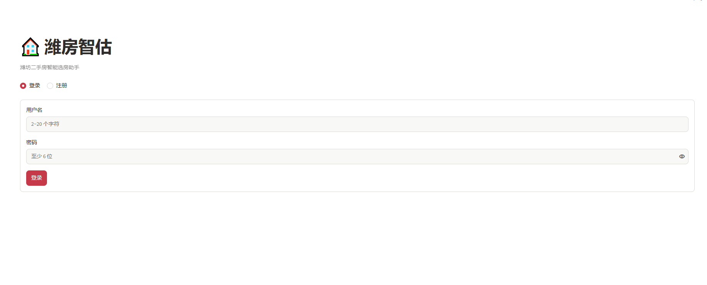
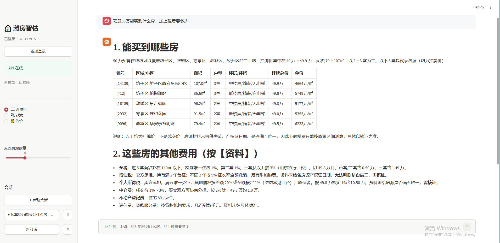
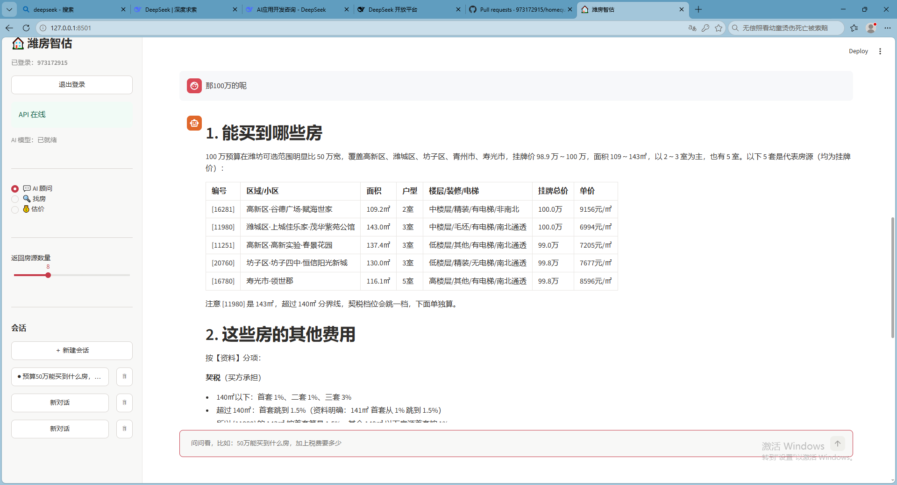
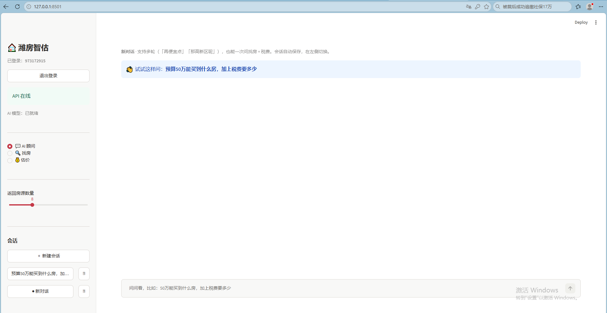

# 潍房智估 · 潍坊二手房 AI 选房助手

用 **LangChain + FAISS + DeepSeek** 做的本地房产问答应用：一句话描述需求，混合检索从 1.8 万条房源里找出符合硬条件的房子，再由大模型生成对比分析和看房建议；问税费、贷款、满二满五，自动切到知识库回答。

| 指标 | 数值 | 说明 |
|---|---|---|
| 意图识别准确率 | **100%** (17/17) | 单意图 / 复合意图 / 闲聊，多标签完全匹配 |
| 槽位抽取准确率 | **100%** (10/10) | 金额、面积、户型、中文数字、区间 |
| 多轮理解通过率 | **100%** (4/4) | 指代、条件继承、「那100万呢」这类追问 |
| 检索 **Precision@10** | **95.5%** | 返回的 10 条里，满足全部硬条件的比例 |
| 检索 **nDCG@10 / MRR** | **95.5% / 0.955** | 合规结果的排序质量，第一条几乎总在第 1 位 |
| 生成 **引用精确率** | **100%** (40 条引用，0 伪造) | 回答里的 `[房源编号]` 是否都真实存在 |
| 生成 **金额精确率** | **100%** (85 个金额，0 不符) | 回答里的金额能否在检索结果中找到出处 |
| 拒答正确率 | **100%** (3/3) | 资料没有的问题，老实说不知道而不是编 |
| 估价误差 MAPE | **10.3%** / **14.7%** | LightGBM，随机切分 / 按小区分组切分（新小区场景） |
| 检索延迟 P50 / P95 | **968ms / 1005ms** | 18332 条房源，CPU 单机 |

> 评测脚本在 `eval/`：`capability.py` 测意图与多轮，`rag_eval.py` 测检索与生成。
> 报告见 [eval/results/](eval/results/)。

---

## 界面预览

**登录 / 注册** —— 会话按用户隔离，密码用 PBKDF2 存储



**AI 顾问** —— 一句话同时问「找房 + 税费」，房源库和知识库两套上下文一起喂给模型



**多轮追问** —— 接着问「那100万呢」，预算、意图自动延续，税费部分不会丢



**多会话管理** —— 会话落 SQLite，刷新、重启都不丢



---

## 功能

**🔍 一句话找房**

输入「奎文区 100平以内 南北通透 精装两居 预算80万」，自动解析出 6 个结构化条件，返回满足全部硬条件的房源卡片（小区、面积、户型、装修、楼层、电梯、朝向、单价）。条件在库里没有匹配时会**明确告诉你放宽了哪一项**，不会偷偷换小区。

**💬 AI 置业顾问**

同一句话交给顾问，输出「推荐列表 → 对比表 → 每套优缺点 → 看房顺序 + 待核实事项」，流式打字机输出，首字 2.7 秒。

**📚 交易知识问答**

问「买一套 100 万的二手房，满两年，契税要交多少」，自动路由到知识库（税费、贷款、过户、满二满五、选房常识），答案带计算过程和出处。

知识库语料基于**现行政策整理**，每篇标注依据文号与生效日期，例如：

- 契税：财政部 税务总局 住建部公告 2024 年第 16 号（2024-12-01 起，分界面积 90㎡ → 140㎡）
- 公积金：潍坊市住房公积金管理中心 2026-05 政策解读（基础额度 100 万，最高可叠加至 180 万）
- 购房资格：潍坊目前不限购，但贷款有套数限制

> 政策会变，代码里保留了"以当地最新公告为准"的提示，产品口径不构成法律依据。

**💰 智能估价**

输入小区、面积、户型、楼层、装修，给出**单价 + 总价 + 80% 区间 + Top5 影响因素**。
模型是 LightGBM，目标是 `log(单价)`，可解释性用 LightGBM 原生的 `pred_contrib`（等价 SHAP，不额外引入依赖）。

**👤 账号与会话**

注册 / 登录后，会话按用户隔离，存在本地 SQLite，刷新浏览器、重启电脑都不丢。

安全上按真实系统的要求做：

| 项 | 做法 |
|---|---|
| 密码存储 | PBKDF2-HMAC-SHA256，20 万次迭代 + 每用户独立盐，**不存明文** |
| 密码校验 | `hmac.compare_digest` 常数时间比较，防时序侧信道 |
| 登录令牌 | 32 字节随机串，库里只存 SHA-256 摘要，7 天过期 |
| 越权防护 | 所有会话读写都带 `user_id` 条件，改 URL 也看不到别人的会话 |
| 接口鉴权 | `/search` `/advice` `/estimate` 均需 `Bearer` token，未登录返回 401 |

> 已知限制：令牌存在 `st.session_state`，**刷新页面需要重新登录**。生产环境应改用 HttpOnly Cookie。

---

## 架构

```
                    ┌──────────────────────────────┐
                    │  Streamlit 界面（2 个页签）    │
                    └───────────────┬──────────────┘
                                    │ HTTP / SSE
                    ┌───────────────▼──────────────┐
                    │  FastAPI                      │
                    │  /search  /advice  /stream    │
                    └───────────────┬──────────────┘
                                    │
              ┌─────────────────────┼─────────────────────┐
              │                     │                     │
     ┌────────▼────────┐   ┌────────▼────────┐   ┌────────▼────────┐
     │ 规则意图解析     │   │ 混合检索        │   │ 生成层           │
     │ parse_query     │   │ BM25 + 向量     │   │ 提示词 + 引用约束 │
     └─────────────────┘   │ + 硬条件过滤    │   └─────────────────┘
                           │ + 业务重排      │
                           └────────┬────────┘
                                    │
              ┌─────────────────────┼─────────────────────┐
              │                     │                     │
     ┌────────▼────────┐   ┌────────▼────────┐   ┌────────▼────────┐
     │ 房源库 18332 条  │   │ 知识库 10 块    │   │ clean.parquet   │
     │ FAISS 索引       │   │ FAISS 索引      │   │ 结构化特征       │
     └─────────────────┘   └─────────────────┘   └─────────────────┘
```

---

## 快速开始

```bash
# 1. 环境（Python 3.12）
python -m venv .venv
.venv\Scripts\activate
pip install torch --index-url https://download.pytorch.org/whl/cpu
pip install -r requirements.txt

# 2. 配置（不填也能跑，会降级成「检索 + 模板摘要」）
copy .env.example .env

# 3. 一条命令启动：建索引 → 起 API → 起界面 → 开浏览器
python run.py
```

打开 <http://127.0.0.1:8501>，接口文档在 <http://127.0.0.1:8000/docs>。

**Docker 部署**（标准路径）：

```bash
docker compose up --build
```

> **国内网络必读**：Docker Hub 官方仓库在国内不可直连，必须在装好 Docker 后配置镜像加速器，
> 否则构建会卡在 `Pulling python:3.12-slim`。
>
> Docker Desktop → Settings → Docker Engine，把 `registry-mirrors` 加进去：
>
> ```json
> {
>   "registry-mirrors": [
>     "https://docker.1ms.run",
>     "https://docker.1panel.live"
>   ]
> }
> ```
>
> 点 Apply & Restart，然后 `docker run --rm hello-world` 验证。
> 公共镜像站可用性经常变化，失效时替换成当时可用的地址即可。

**没有 Docker Desktop 也能跑**（Windows 10 LTSC 等无法安装 Desktop 的场景）：

本项目的镜像已在 **WSL2 + Debian + Docker Engine 20.10** 下完整验证（构建、启动、三个接口均通过）。
若你也走这条路，注意两点：

```bash
# 1. WSL 里的 dockerd 需要手动拉起（没有 systemd）
nohup dockerd --host=unix:///var/run/docker.sock >/var/log/dockerd.log 2>&1 &

# 2. 用 host 网络模式：WSL 下 docker-proxy 有时不监听端口，-p 映射会失效
docker build -t housing-ai .
docker run -d --name housing -P --network host -e APP_HOST=0.0.0.0 \
  -v "$PWD/artifacts:/app/artifacts" housing-ai
```

> Linux 下 `pip install torch` 会拉 CUDA 版（+2~3 GB），Dockerfile 里已改为从
> `download.pytorch.org/whl/cpu` 单独安装，镜像控制在 2.1 GB。

---

## 估价模型

目标不是「预测总价」，而是 `log(单价)`——总价 = 单价 × 面积，面积作为特征进去就够了，这样不同面积的样本能放在同一尺度上学。

两种切分都跑，因为差距本身就是结论：

| 方法 | 切分方式 | MAPE | MAE（元/㎡） | R² |
|---|---|---|---|---|
| 全局中位数 | 按小区分组 | 21.76% | — | — |
| 区县中位数 | 按小区分组 | 18.86% | — | — |
| 商圈中位数 | 按小区分组 | 18.14% | — | — |
| **LightGBM** | 随机切分 | **10.34%** | 742 | 0.71 |
| **LightGBM** | 按小区分组切分 | **14.72%** | 1088 | 0.51 |

- **随机切分偏乐观**：同一小区的房源同时进了训练集和测试集，模型等于「见过这个小区」。
- **按小区分组切分才是线上场景**：用户问的房子往往来自模型没见过的楼盘，这才是真实精度。
- 两者 4.4 个点的差距，就是「小区记忆」带来的虚高。

```bash
python scripts/train_model.py   # 训练 + 生成 eval/results/model_eval.md
```

---

## 评测

分两套脚本，覆盖从意图到生成的全链路。

```bash
# 能力评测：意图识别 + 槽位抽取 + 多轮理解（含 LLM，约 1 分钟）
python eval/capability.py
python eval/capability.py --no-llm     # 只跑意图与检索，几秒

# RAG 评测：检索层指标 + 生成层事实性（含 LLM，约 1 分钟）
python eval/rag_eval.py
python eval/rag_eval.py --no-gen       # 只跑检索，3 秒
```

### 检索层

相关性定义：**满足全部硬条件**。22 条人工标注查询。

| 指标 | 结果 | 含义 |
|---|---|---|
| Precision@10 | **95.5%** | 返回的 10 条里合规的比例 |
| nDCG@10 | **95.5%** | 合规结果排得够不够靠前 |
| MRR | **0.955** | 第一条合规结果的位置（1.0 = 永远第 1 条） |
| 无结果率 | **0%** | 没有搜出 0 条的情况 |
| 延迟 P50 / P95 | 968ms / 1005ms | 18332 条候选 |

> 三个指标数值相同是正常的：相关性是二值的，21 条全对（10/10）、1 条全错（0/10），
> 平均下来都是 0.955。若引入分级相关性（价格越接近预算越相关），nDCG 才会与 Precision 拉开。
>
> 不报 Recall@10 的原因：gold 集合常有几十上百条，Recall@10 上限就是 10/62 = 16%，
> 反映的是「Top10 装不下」，不是系统差。

### 生成层

按**断言级**统计，而不是「整条回答是否干净」——一条回答里 13 个金额错 1 个，
应该记 1/13 的损失，而不是整条清零。

| 指标 | 结果 |
|---|---|
| 引用精确率 | **100%**（40 条引用，0 条伪造） |
| 金额精确率 | **100%**（85 个金额，0 个不符） |
| 拒答正确率 | **100%**（3/3） |
| 端到端 P50 | 6.0s |

---

## 项目结构

```
housing/
├── config.py              # pydantic-settings，密钥走 .env
├── ingest/
│   ├── clean.py           # 4 个中文串字段解析 + 异常剔除
│   ├── build_docs.py      # 房源 → Document（不切块）
│   └── build_kb.py        # 知识库切块 400/60
├── search/
│   ├── tokenizer.py       # 中文二元组分词
│   ├── embeddings.py      # bge + query 指令前缀
│   ├── retriever.py       # 解析 + 混合检索 + 硬过滤 + 重排
│   ├── knowledge.py       # 知识库检索
│   └── faiss_store.py     # FAISS 读写（绕过中文路径问题）
├── estimate/
│   └── model.py           # LightGBM 估价 + pred_contrib 解释
└── advisor/
    ├── prompts.py         # 防幻觉提示词
    ├── llm.py             # DeepSeek 客户端 + 降级
    └── chain.py           # LCEL 链 + 问题路由
app/api/main.py            # FastAPI 5 个接口（含 /estimate）
app/ui/streamlit_app.py    # 界面（找房 / 估价 / 顾问 三个页签）
eval/                      # 评测集 + 评测脚本 + 结果
scripts/                   # 数据体检、建索引、训练、检索冒烟
run.py                     # 一键启动
```

---

## 数据说明

- 仓库内附 `data/sample_2000.csv`：从全量数据按区县**分层抽样**的 2000 条，分布与全量一致
- 如果你有完整数据，放回 `data/sh_data.csv`，代码会自动优先使用它（`config.data_raw`）
- 全量 18339 条 → 清洗后 18332 条（剔除 7 条单价异常），8 个区县、65 个商圈、1750 个小区
- 价格为**挂牌价**，不是成交价；模型不承诺投资回报
- 数据集仅用于技术演示

> 注意：`eval/` 里的指标是在**全量数据**上跑出来的。用 2000 条样本复现时数字会偏低
> （候选池小，检索更容易命中，但估价类指标会波动）。

---

## 文档

| 文档 | 内容 |
|---|---|
| [技术全景](docs/技术全景.md) | 11 个阶段的技术选型与决策依据 |
| [RAG 设计](docs/RAG设计.md) | 切块策略、混合检索、硬过滤、引用约束 |
| [项目流程](docs/项目流程.md) | 从数据到上线的完整步骤 |

---

## Roadmap

- [x] 估价模块：LightGBM 预测单价 + interval + 影响因素（MAPE 10.3% / 14.7%）
- [ ] 把估价接成 LangChain `@tool`，让顾问自己决定何时调用
- [ ] MCP Server：把房源查询暴露成标准工具
- [ ] Langfuse 埋点：token / 延迟 / 成本
